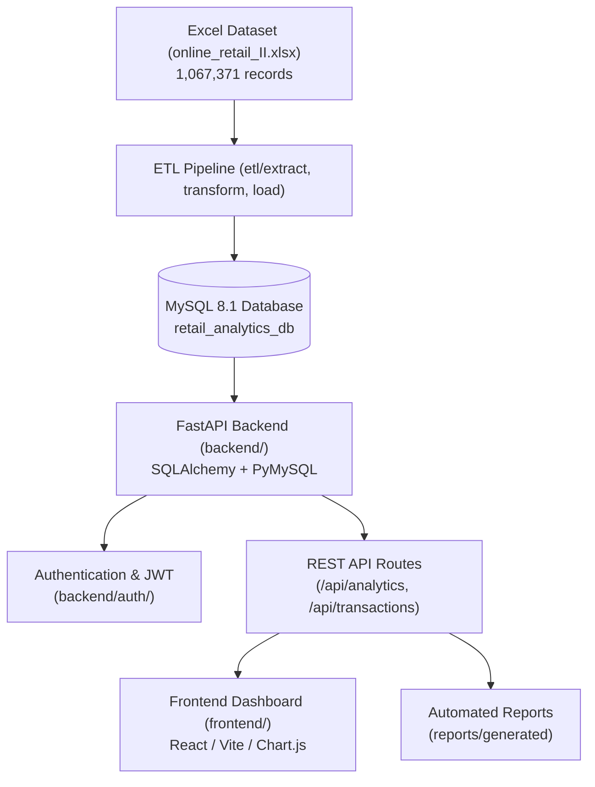

# Retail Transaction Analytics Platform - Architecture

## 1. System Overview

The Retail Transaction Analytics Platform processes, stores, and serves high-volume retail transactional records (1,067,371 rows from Online Retail II) using modern Python and Web technologies.

## 2. Directory Structure

* **`backend/`**: FastAPI web application, API routers, database models, and authentication services.
* **`etl/`**: Data ingestion, schema cleaning, transformation, and batch loading utilities.
* **`sql/`**: Schema DDL scripts, table definitions, and analytical query indexing scripts.
* **`frontend/`**: Single-page application dashboard for visualizations and filtering.
* **`tests/`**: Automated unit and integration test suites using pytest.
* **`docs/`**: Technical and setup documentation.
